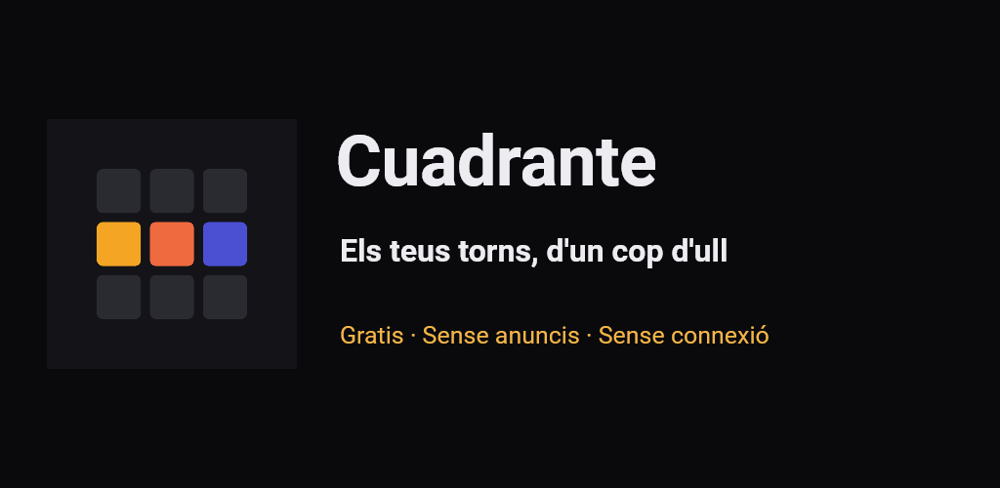
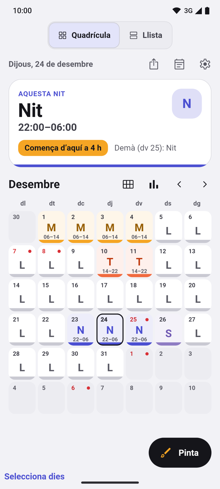
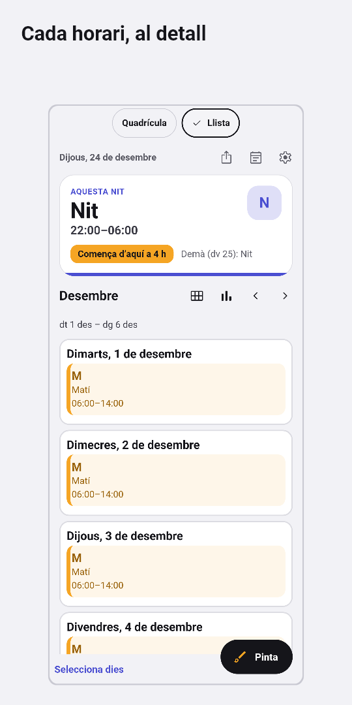
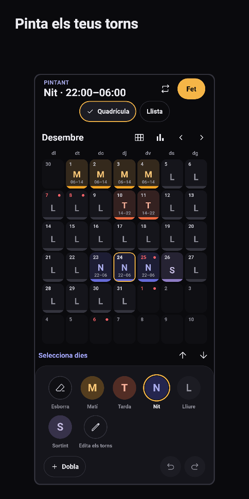
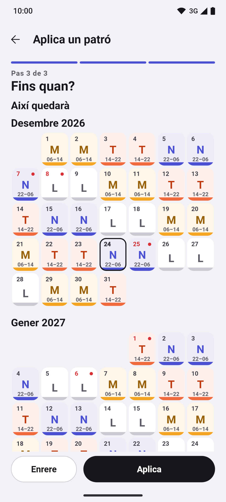
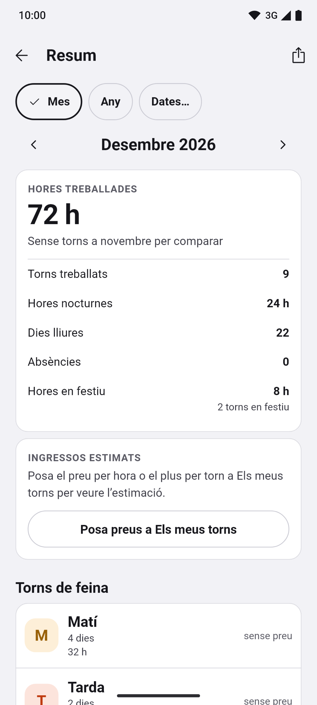
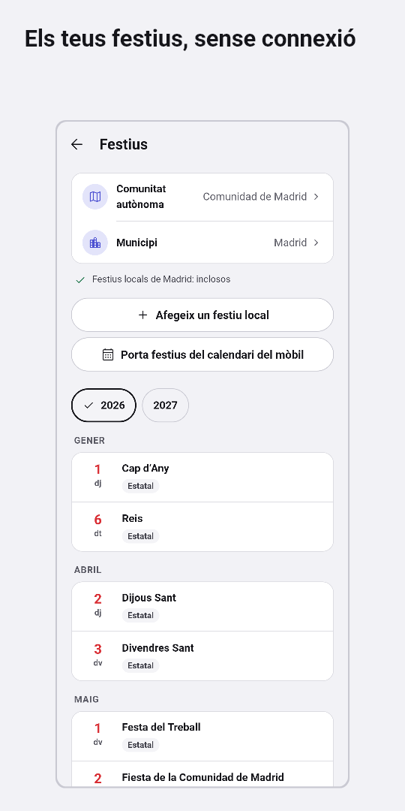
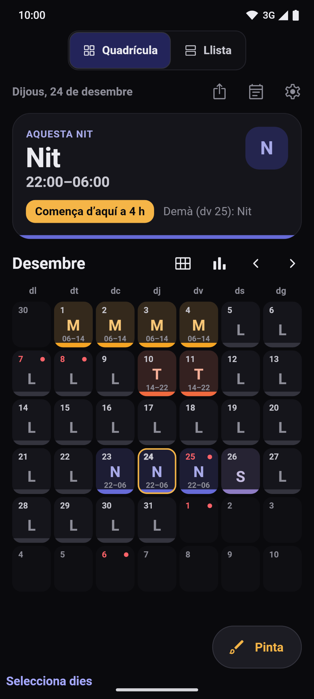

[English](README.md) · [Español](README.es.md) · **Català** · [Galego](README.gl.md) · [Euskara](README.eu.md)

  

# Turnly

Abans es deia Cuadrante.

Calendari de torns per a qui treballa a torns a Espanya: sanitat, policia,
bombers, indústria, hostaleria o qualsevol altre sector. Organitza matins, tardes,
nits, guàrdies i dies lliures, i consulta el proper torn d’un cop d’ull. Cinc
idiomes: español, català, galego, euskara i English.

**Gratis · Sense anuncis · Sense compte · Sense connexió · Codi obert**

Totes les funcions disponibles són obertes, sense Pro ni compres dins de l’app.

## Baixades

  
  
  <!--
  
  -->

Android en proves; iPhone, aviat. Mode clar i fosc.

Uneix-te a la beta de Google Play

L’app és en prova tancada a Google Play i s’hi pot apuntar qualsevol persona:

> **Ara mateix Google està revisant la primera versió.** Ja et pots unir al grup (pas 1); l’enllaç del pas 2 funcionarà quan l’aprovin, normalment en pocs dies.

1. Uneix-te al grup de testers: [turnly-testers](https://groups.google.com/g/turnly-testers). Amb el teu compte de Google, prem «Uneix-te al grup».
2. Accepta la prova des del mòbil o l’ordinador: [play.google.com/apps/testing/es.cuadrante.app](https://play.google.com/apps/testing/es.cuadrante.app).
3. Instal·la l’app des de Google Play. S’actualitzarà sola.

Si pots, queda’t a la prova almenys 14 dies i fes-la servir de tant en tant (per exemple, mira el torn de demà o posa el widget): Google exigeix 12 testers durant 14 dies per publicar-la per a tothom. Els comentaris, a dev@mainshai.com.

Instal·la l’APK des de GitHub

També pots baixar l’APK de la [darrera versió](https://github.com/dferrandizmont/turnly/releases/latest) i instal·lar-lo a mà (cal permetre «instal·lar aplicacions d’origen desconegut»). Està signat amb una clau diferent de la de la versió de Google Play, així que l’una no actualitza l’altra: per canviar, exporta abans una còpia des de l’app (`.turnly`; les versions anteriors la desen com a `.cuadrante`).

Aviat a l’App Store.

## Captures

  
  
  
  
  

Més captures

  
  

Prem una captura per ampliar-la. Pantalles reals amb dades fictícies, generades
per [tests de Flutter](app/test/store/), també [en castellà](README.es.md#capturas).

## Funcions

- **Mes en Quadrícula o Llista.** Vista anual, agenda i notes per dia. Cada torn
  porta color, codi i horari; la Llista permet llegir els horaris complets.
  Exportació puntual al calendari del mòbil i imatges del mes i de l’any.
- **Pintar torns i rotacions.** Toca o arrossega per seleccionar diversos dies,
  doblar, copiar i enganxar, desfer i refer; assistent de rotacions amb vista
  prèvia: torns rotatius, 24/72, 4×4, 6×4, 5×2, 2-2-3 i patrons propis. Tipus de
  torn, colors, icones i horaris editables.
- **Festius d’Espanya.** Nacionals i autonòmics inclosos sense connexió; locals
  per als municipis disponibles i opció d’afegir-hi els teus.
- **Alarmes i widgets.** Alarma per tipus de torn, recordatoris de notes i widgets
  d’Android per consultar els teus torns des de la pantalla d’inici. La seva
  puntualitat depèn dels permisos i les restriccions del sistema. El widget d’iPhone
  (WidgetKit) està pendent de desenvolupar al Mac.
- **Còpies de seguretat i importació.** Còpies de seguretat locals automàtiques,
  exportació a `.turnly` (les còpies antigues `.cuadrante` encara s’obren), vista prèvia en restaurar i «Prova la restauració».
  Importar còpies `.Shifter` de LRHSoft, fitxers `.ics` o CSV i esdeveniments del
  calendari del mòbil, revisant els torns abans de desar-los.
- **Resum d’hores.** Treballades, nocturnes, festives, extra i sortides
  anticipades; estimació d’ingressos amb preu per hora i plus fix per torn.

Més funcions

- **Diversos calendaris.** Sense límit de pagament, i comparació entre dos quadrants.
- **Accessibilitat.** Selector d’idioma, lector de pantalla, text ampliable i
  torns que mai no depenen només del color.

## Privacitat

Els torns i la configuració es desen al mòbil. Sense servidor propi, analítica,
seguiment ni enviament d’informes d’errors. L’app demana permís de **calendari** en
importar o exportar, i de **notificacions i alarmes** en activar els avisos.

Permisos i còpies

No demana ubicació, contactes, càmera ni micròfon.

Les còpies del sistema de Google o Apple poden incloure les teves dades, també les
absències. Si exportes a un calendari sincronitzat o comparteixes una còpia, les
dades van a la destinació que triïs. El fitxer de còpia `.turnly` no està xifrat.

[Política de privacitat](https://dferrandizmont.github.io/turnly/privacidad/) ·
[Detall tècnic](docs/privacy.md) (en castellà) · Suport: **dev@mainshai.com**.

## Novetats

Els canvis de cada versió són al [CHANGELOG.md](CHANGELOG.md) i a les
[versions publicades](https://github.com/dferrandizmont/turnly/releases).

## Contribuir

Els informes d’errors, les idees i les traduccions són benvinguts. Com compilar,
provar i col·laborar: [CONTRIBUTING.es.md](CONTRIBUTING.es.md).

## Llicència

Codi [MIT](LICENSE), Copyright (c) 2026 Daniel Mont Ferrandiz. Contingut propi
[CC BY-SA 4.0](LICENSE-CONTENT.md). Les fonts oficials de festius i els materials
de tercers conserven les seves condicions, detallades en aquestes llicències.

Per comunicar una vulnerabilitat: [SECURITY.md](SECURITY.md).
