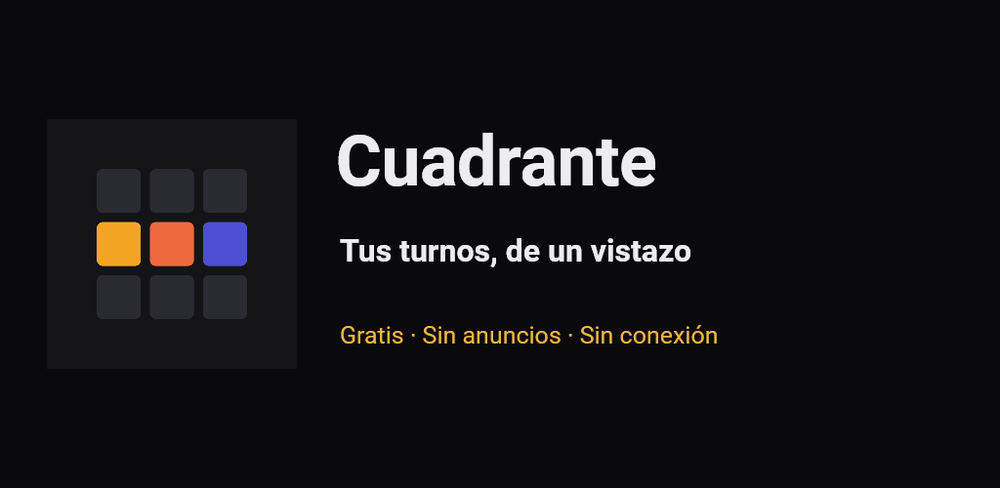
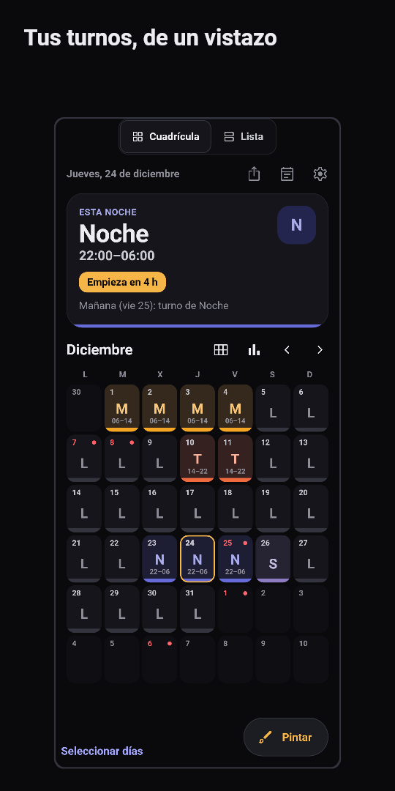
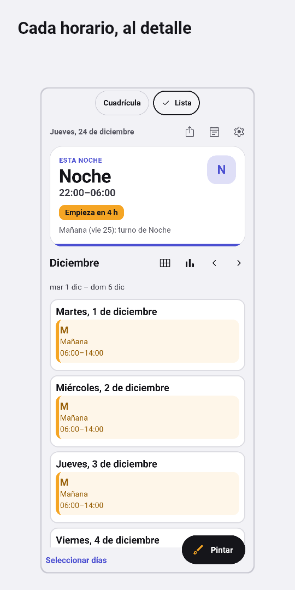
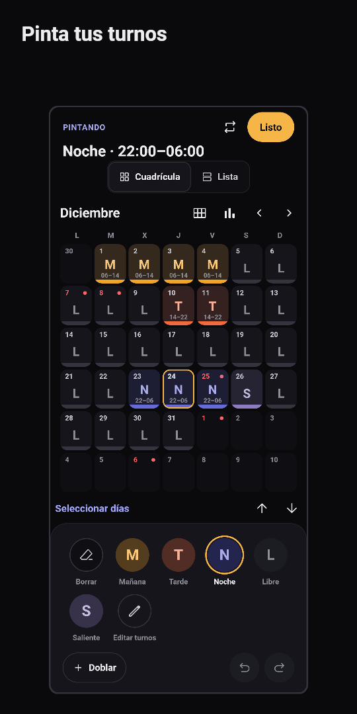
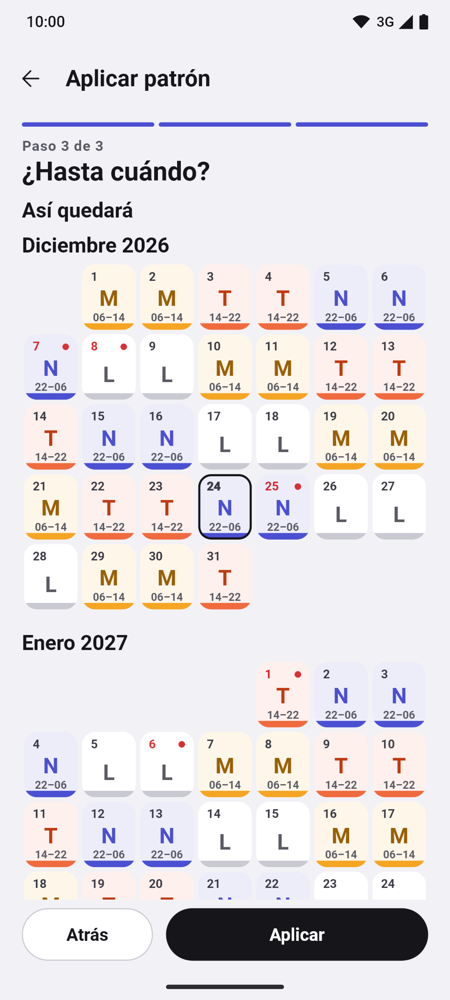
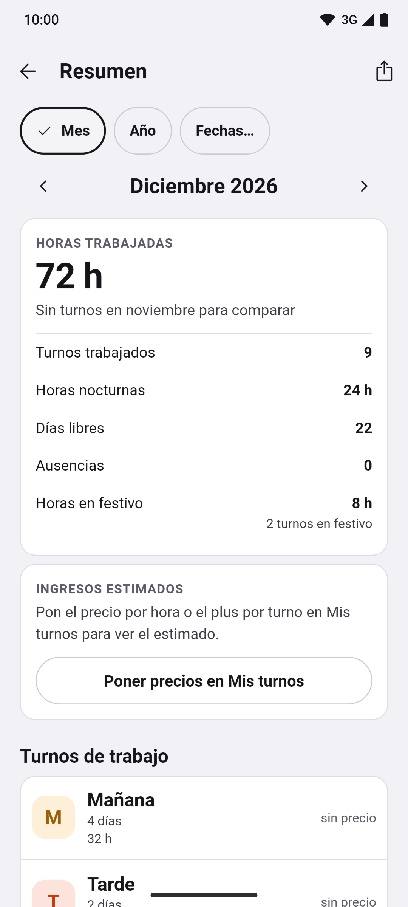
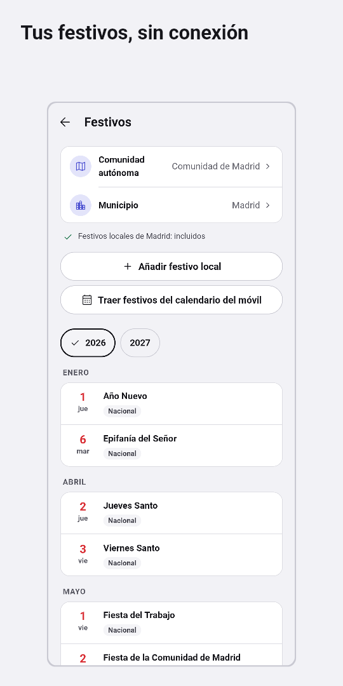
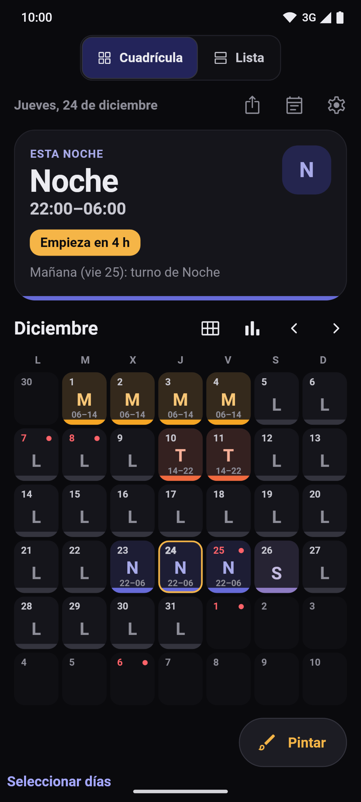

[English](README.md) · **Español** · [Català](README.ca.md) · [Galego](README.gl.md) · [Euskara](README.eu.md)

  

# Turnly

Antes se llamaba Cuadrante.

Calendario de turnos para quienes trabajan a turnos en España: sanidad, policía,
bomberos, industria, hostelería o cualquier otro sector. Organiza mañanas, tardes,
noches, guardias y días libres, y consulta el próximo turno de un vistazo. Cinco
idiomas: español, català, galego, euskara y English.

**Gratis · Sin anuncios · Sin cuenta · Funciona sin conexión · Código abierto**

Todas las funciones disponibles están abiertas, sin Pro ni compras dentro de
la app.

## Descargas

  
  
  <!--
  
  -->

Android en pruebas; iPhone, próximamente. Modo claro y oscuro.

Únete a la beta de Google Play

La app está en prueba cerrada en Google Play y cualquiera puede apuntarse:

> **Ahora mismo Google está revisando la primera versión.** Ya puedes unirte al grupo (paso 1); el enlace del paso 2 funcionará en cuanto la aprueben, normalmente en pocos días.

1. Únete al grupo de testers: [turnly-testers](https://groups.google.com/g/turnly-testers). Con tu cuenta de Google, pulsa «Unirse al grupo».
2. Acepta la prueba desde el móvil o el ordenador: [play.google.com/apps/testing/es.cuadrante.app](https://play.google.com/apps/testing/es.cuadrante.app).
3. Instala la app desde Google Play. Se actualizará sola.

Si puedes, quédate en la prueba al menos 14 días y úsala de vez en cuando (por ejemplo, mira tu turno de mañana o pon el widget): Google exige 12 testers durante 14 días para publicarla para todo el mundo. Los comentarios, a dev@mainshai.com.

Instala el APK desde GitHub

También puedes descargar el APK de la [última versión](https://github.com/dferrandizmont/turnly/releases/latest) e instalarlo a mano (hay que permitir «instalar aplicaciones de origen desconocido»). Va firmado con otra clave que la versión de Google Play, así que una no actualiza a la otra: para cambiar, exporta antes una copia desde la app (`.turnly`; las versiones anteriores la guardan como `.cuadrante`).

Próximamente en App Store.

## Capturas

  
  
  
  
  

Más capturas

  
  

Pulsa una captura para ampliarla. Pantallas reales con datos ficticios, generadas
por [tests de Flutter](app/test/store/), también [en inglés](README.md#screenshots).

## Funciones

- **Mes en Cuadrícula o Lista.** Vista anual, agenda y notas por día. Cada turno
  lleva color, código y horario; la Lista permite leer los horarios completos.
  Exportación puntual al calendario del móvil e imágenes del mes y del año.
- **Pintar turnos y rotaciones.** Toca o arrastra para seleccionar varios días,
  doblar, copiar y pegar, deshacer y rehacer; asistente de rotaciones con vista
  previa: correturnos, 24/72, 4×4, 6×4, 5×2, 2-2-3 y patrones propios. Tipos de
  turno, colores, iconos y horarios editables.
- **Festivos de España.** Nacionales y autonómicos incluidos sin conexión; locales
  para los municipios disponibles y opción de añadir los tuyos.
- **Alarmas y widgets.** Alarma por tipo de turno, recordatorios de notas y widgets
  de Android. La puntualidad depende de los permisos y las restricciones del
  sistema. El widget de iPhone (WidgetKit) está pendiente de desarrollo en el Mac.
- **Copias de seguridad e importación.** Copias de seguridad locales automáticas,
  exportación a `.turnly` (las copias antiguas `.cuadrante` se siguen abriendo), vista previa al restaurar y «Probar restauración».
  Importar copias `.Shifter` de LRHSoft, archivos `.ics` o CSV y eventos del
  calendario del móvil, revisando los turnos antes de guardarlos.
- **Resumen de horas.** Trabajadas, nocturnas, festivas, extras y salidas
  anticipadas; estimación de ingresos con precio por hora y plus fijo por turno.

Más funciones

- **Varios calendarios.** Sin límite de pago, y comparación entre dos cuadrantes.
- **Accesibilidad.** Selector de idioma, lector de pantalla, texto ampliable y
  turnos que nunca dependen solo del color.

## Privacidad

Los turnos y ajustes se guardan en el móvil. Sin servidor propio, analítica,
rastreo ni envío de informes de errores. La app pide permiso de **calendario** al
importar o exportar, y de **notificaciones y alarmas** al activar los avisos.

Permisos y copias

No pide ubicación, contactos, cámara ni micrófono.

Las copias del sistema de Google o Apple pueden incluir tus datos, también las
ausencias. Si exportas a un calendario sincronizado o compartes una copia, los
datos van al destino que elijas. El archivo de copia `.turnly` no está cifrado.

[Política de privacidad](https://dferrandizmont.github.io/turnly/privacidad/) ·
[Detalle técnico](docs/privacy.md) · Soporte: **dev@mainshai.com**.

## Novedades

Lo que cambia en cada versión está en [CHANGELOG.md](CHANGELOG.md) y en las
[versiones publicadas](https://github.com/dferrandizmont/turnly/releases).

## Contribuir

Son bienvenidos los informes de errores, las ideas y las traducciones. Cómo
compilar, probar y contribuir: [CONTRIBUTING.es.md](CONTRIBUTING.es.md).

## Licencia

Código [MIT](LICENSE), Copyright (c) 2026 Daniel Mont Ferrandiz. Contenido propio
[CC BY-SA 4.0](LICENSE-CONTENT.md). Las fuentes oficiales de festivos y los
materiales de terceros conservan sus condiciones, detalladas en esas licencias.

Para comunicar una vulnerabilidad: [SECURITY.md](SECURITY.md).
