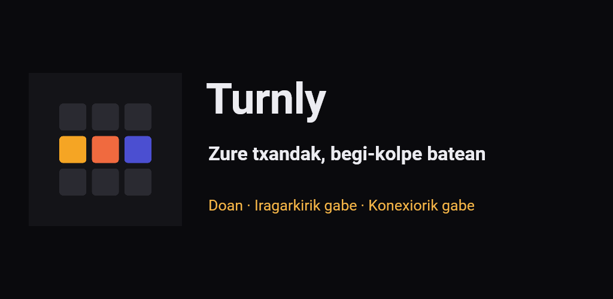
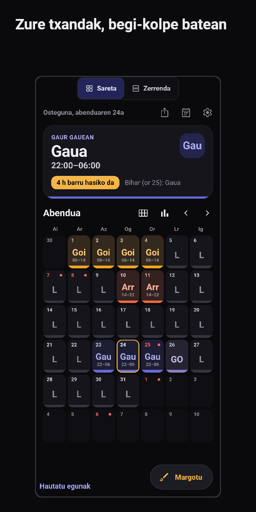
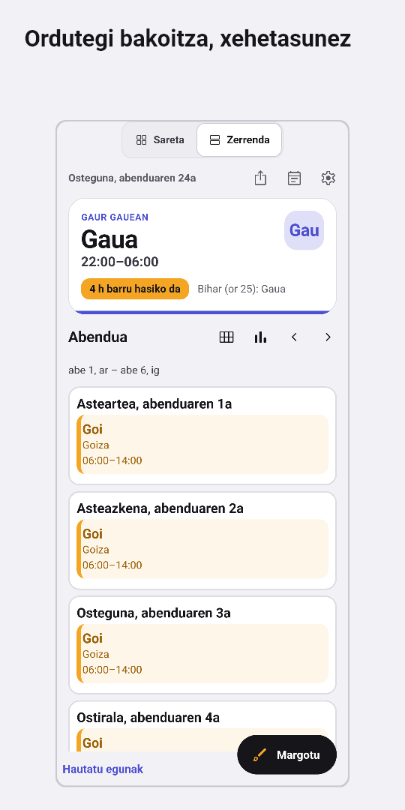
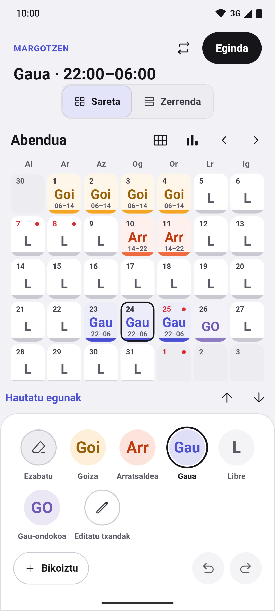
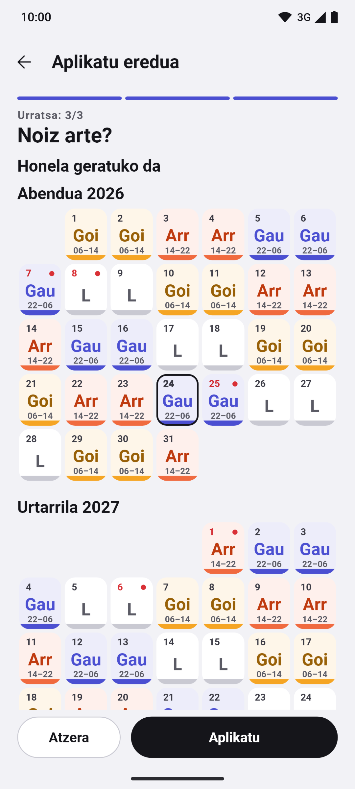
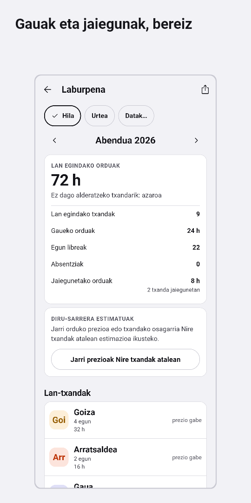
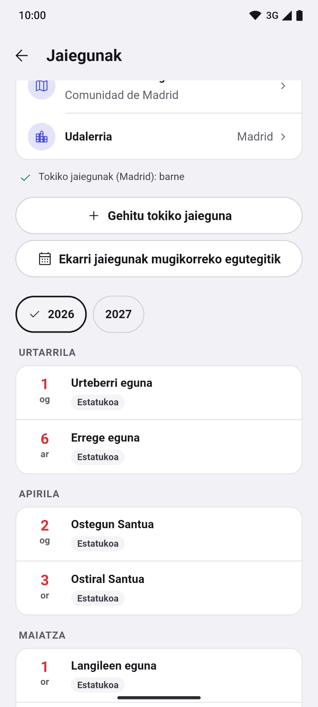
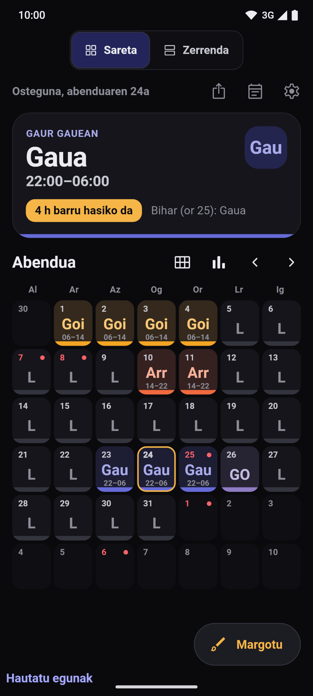

[English](README.md) · [Español](README.es.md) · [Català](README.ca.md) · [Galego](README.gl.md) · **Euskara**

  

# Turnly

Lehen Cuadrante zuen izena.

Txanden egutegia Espainian txandaka lan egiten dutenentzat: osasungintza, polizia,
suhiltzaileak, industria, ostalaritza edo beste edozein sektore. Antolatu goizak,
arratsaldeak, gauak, guardiak eta egun libreak, eta ikusi hurrengo txanda begi-kolpe
batean. Bost hizkuntza: español, català, galego, euskara eta English.

**Doakoa · Iragarkirik gabe · Konturik gabe · Konexiorik gabe · Kode irekia**

Eskuragarri dauden funtzio guztiak irekita daude, Pro bertsiorik eta aplikazio
barneko erosketarik gabe.

## Deskargak

  
  
  <!--
  
  -->

Android probetan; iPhone, laster. Modu argia eta iluna.

Sartu Google Play-ko betan

Aplikazioa proba itxian dago Google Play-n, eta edonor sar daiteke:

1. Sartu testerren taldean: [turnly-testers](https://groups.google.com/g/turnly-testers). Zure Google kontuarekin, sakatu taldean sartzeko botoia.
2. Onartu proba mugikorretik edo ordenagailutik: [play.google.com/apps/testing/es.cuadrante.app](https://play.google.com/apps/testing/es.cuadrante.app).
3. Instalatu aplikazioa Google Play-tik. Bere kabuz eguneratuko da.

Ahal baduzu, egon proban gutxienez 14 egunez eta erabili noizean behin (adibidez, begiratu biharko txanda edo jarri widgeta): Google-k 12 tester eskatzen ditu 14 egunez, aplikazioa guztientzat argitaratzeko. Iruzkinak, turnly@mainshai.com helbidera.

Instalatu APKa GitHub-etik

[Azken bertsioaren](https://github.com/dferrandizmont/turnly/releases/latest) APKa ere deskarga dezakezu eta eskuz instalatu (jatorri ezezaguneko aplikazioak instalatzea baimendu behar da). Google Play-ko bertsioaren beste gako batekin dago sinatuta; beraz, batak ez du bestea eguneratzen: aldatzeko, esportatu lehenago kopia bat aplikaziotik (`.turnly`; aurreko bertsioek `.cuadrante` gisa gordetzen dute).

## Pantaila-argazkiak

  
  
  
  
  

Pantaila-argazki gehiago

  
  

Sakatu pantaila-argazki bat handitzeko. Benetako pantailak dira, datu asmatuekin, eta
[Flutter-en testek](app/test/store/) sortzen dituzte; [gaztelaniaz](README.es.md#capturas) ere badaude.

## Funtzioak

- **Hilabetea Sareta edo Zerrenda gisa.** Urteko ikuspegia, agenda eta eguneko
  oharrak. Txanda bakoitzak kolorea, kodea eta ordutegia ditu; Zerrendan ordutegi
  osoak irakur daitezke. Noizbehinka esportatzea mugikorreko egutegira, eta
  hilabetearen eta urtearen irudiak.
- **Txandak margotzea eta txandaketak.** Ukituz edo arrastatuz, hainbat egun
  hautatu, bikoiztu, kopiatu eta itsatsi, desegin eta berregin; txandaketen
  laguntzailea aurrebistarekin: txanda birakariak, 24/72, 4×4, 6×4, 5×2, 2-2-3
  eta eredu propioak. Txanda motak, koloreak, ikonoak eta ordutegiak editagarriak
  dira.
- **Espainiako jaiegunak.** Estatukoak eta erkidegokoak konexiorik gabe datoz; tokikoak,
  eskuragarri dauden udalerrietarako, eta zureak gehitzeko aukera.
- **Alarmak eta widgetak.** Alarmak txanda motaren arabera, oharren gogorarazpenak
  eta Androiderako widgetak zure txandak hasierako pantailatik ikusteko.
  Puntualtasuna sistemaren baimenen eta murrizketen araberakoa da. iPhoneko
  widgeta (WidgetKit) Mac-ean garatzeko dago oraindik.
- **Babeskopia lokala eta inportatzea.** Tokiko babeskopia automatikoak,
  `.turnly` fitxategira esportatzea (`.cuadrante` kopia zaharrak ere irekitzen dira), leheneratu aurreko aurrebista eta «Probatu
  leheneratzea». LRHSoft-en `.Shifter` kopiak, `.ics` edo CSV fitxategiak eta
  mugikorreko egutegiko gertaerak inportatzea, txandak gorde aurretik berrikusita.
- **Orduen laburpena.** Lan egindako orduak, gaueko orduak, jaiegunetako orduak,
  aparteko orduak eta irteera aurreratuak; diru-sarreren estimazioa, orduko
  prezioarekin eta txandako osagarri finkoarekin.

Funtzio gehiago

- **Hainbat egutegi.** Ordaindu beharreko mugarik gabe, eta bi egutegi alderatzeko
  aukera.
- **Irisgarritasuna.** Hizkuntza-hautatzailea, pantaila-irakurgailua eta testu
  handigarria; txandak ez daude inoiz kolorearen mende bakarrik.

## Pribatutasuna

Txandak eta ezarpenak mugikorrean gordetzen dira. Ez dago zerbitzari propiorik,
analitikarik, jarraipenik ezta errore-txostenen bidalketarik ere. Aplikazioak
**egutegirako** baimena eskatzen du inportatzean edo esportatzean, eta
**jakinarazpenetarako eta alarmetarako** baimena abisuak aktibatzean.

Baimenak eta kopiak

Ez du kokapenik, kontakturik, kamerarik ezta mikrofonorik eskatzen.

Google-ren edo Apple-ren sistemako kopiek zure datuak izan ditzakete, absentziak
barne. Sinkronizatutako egutegi batera esportatzen baduzu edo kopia bat partekatzen
baduzu, datuak zuk aukeratutako helmugara joaten dira. `.turnly` kopia-fitxategia ez
dago zifratuta.

[Webgunea](https://turnly.mainshai.com/eu/) · [Pribatutasun-politika](https://turnly.mainshai.com/eu/privacy/) ·
[Xehetasun teknikoak](docs/privacy.md) (gaztelaniaz) · Laguntza: **turnly@mainshai.com**.

## Berriak

Zer aldatu den bertsio bakoitzean [CHANGELOG.md](CHANGELOG.md) eta
[argitalpenetan](https://github.com/dferrandizmont/turnly/releases) dago.

## Lagundu

Akatsen berriak, ideiak eta itzulpenak onartzen ditugu. Nola konpilatu, probatu
eta lagundu: [CONTRIBUTING.es.md](CONTRIBUTING.es.md).

## Lizentziak

Kodea: [MIT](LICENSE), Copyright (c) 2026 Daniel Mont Ferrandiz. Eduki propioa:
[CC BY-SA 4.0](LICENSE-CONTENT.md). Jaiegunen iturri ofizialek eta hirugarrenen
materialek beren baldintzak dituzte, lizentzia horietan zehaztuta.

Ahultasun baten berri emateko: [SECURITY.md](SECURITY.md).
