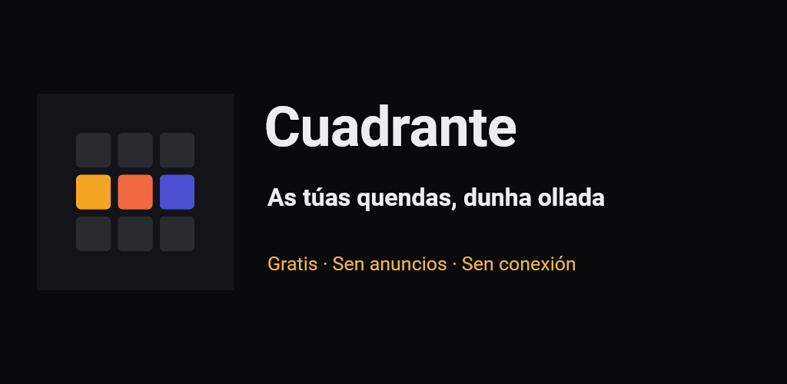
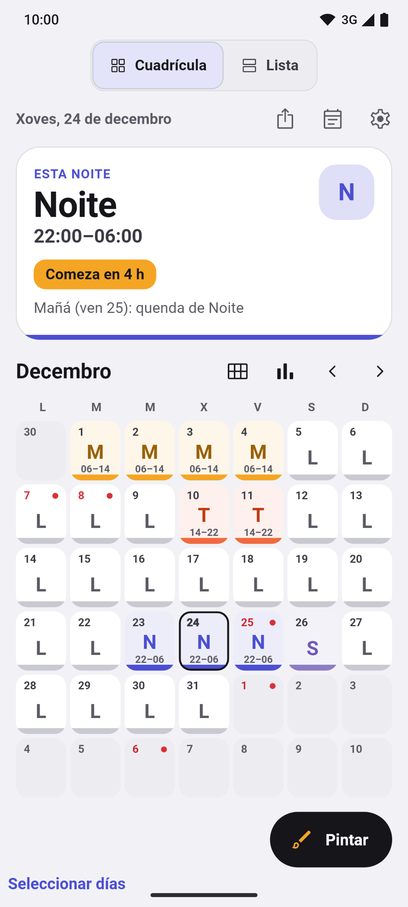
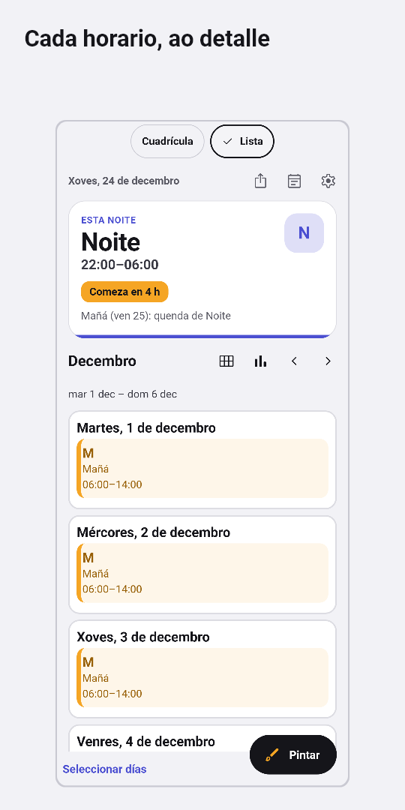
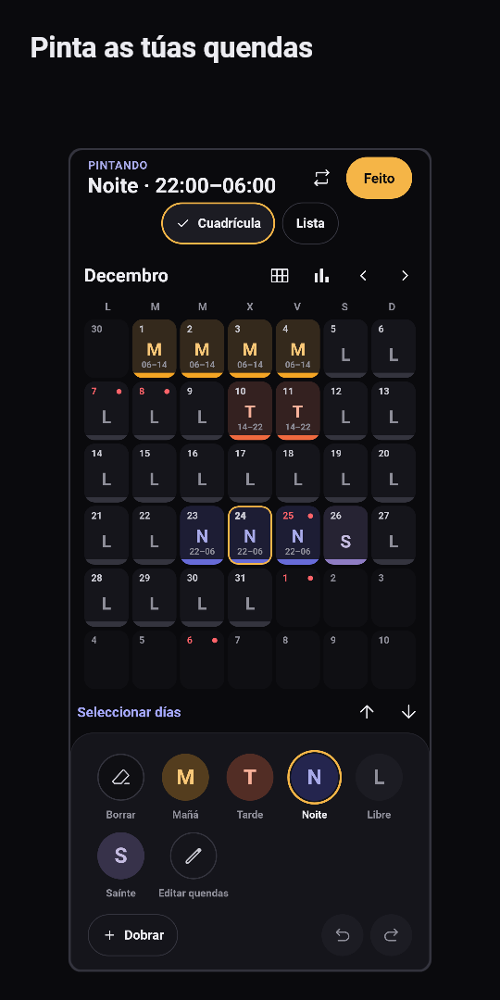
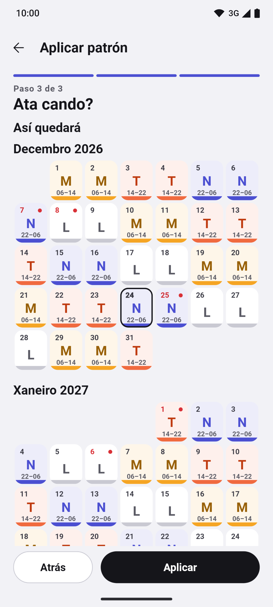
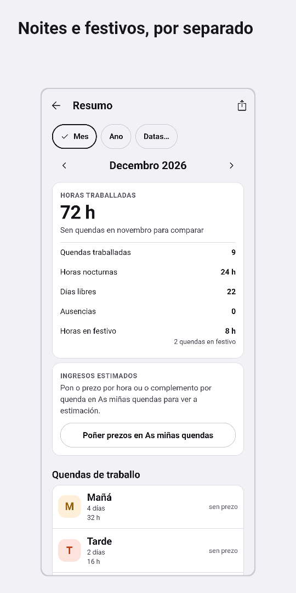
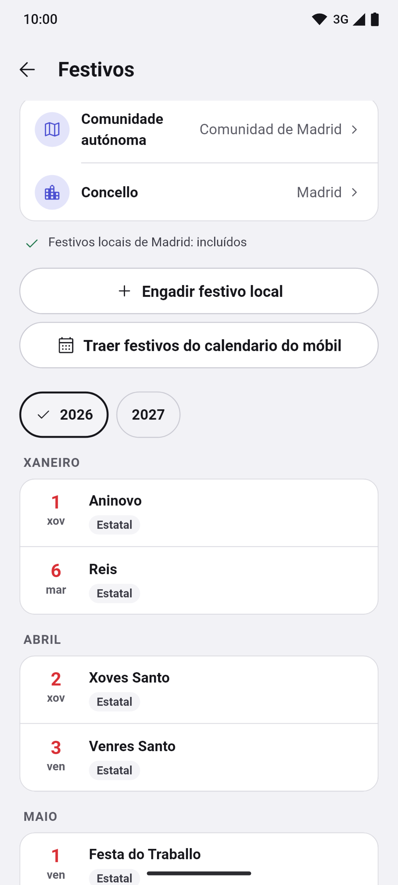
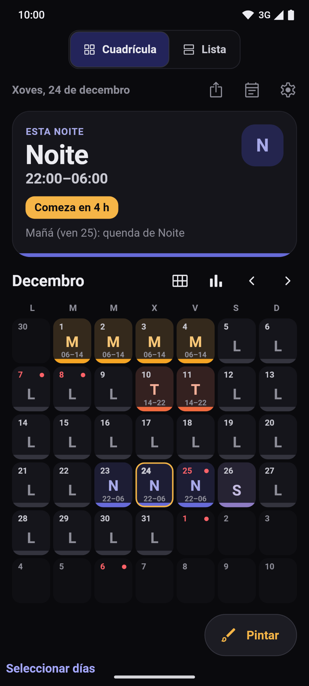

[English](README.md) · [Español](README.es.md) · [Català](README.ca.md) · **Galego** · [Euskara](README.eu.md)

  

# Turnly

Antes chamábase Cuadrante.

Calendario de quendas para quen traballa a quendas en España: sanidade, policía,
bombeiros, industria, hostalaría ou calquera outro sector. Organiza mañás, tardes,
noites, gardas e días libres, e consulta a próxima quenda dunha ollada. Cinco
idiomas: español, català, galego, euskara e English.

**Gratis · Sen anuncios · Sen contas · Sen conexión · Código aberto**

Todas as funcións dispoñibles están abertas, sen Pro nin compras dentro da app.

## Descargas

  
  
  <!--
  
  -->

Android en probas; iPhone, proximamente. Modo claro e escuro.

Únete á beta de Google Play

A app está en proba pechada en Google Play e calquera pode apuntarse:

1. Únete ao grupo de testers: [turnly-testers](https://groups.google.com/g/turnly-testers). Coa túa conta de Google, preme «Unirse ao grupo».
2. Acepta a proba desde o móbil ou o ordenador: [play.google.com/apps/testing/es.cuadrante.app](https://play.google.com/apps/testing/es.cuadrante.app).
3. Instala a app desde Google Play. Actualizarase soa.

Se podes, quédate na proba polo menos 14 días e úsaa de cando en vez (por exemplo, mira a túa quenda de mañá ou pon o widget): Google esixe 12 testers durante 14 días para publicala para todo o mundo. Os comentarios, a turnly@mainshai.com.

Instala o APK desde GitHub

Tamén podes descargar o APK da [última versión](https://github.com/dferrandizmont/turnly/releases/latest) e instalalo á man (hai que permitir «instalar aplicacións de orixe descoñecida»). Vai asinado cunha clave distinta da versión de Google Play, así que unha non actualiza a outra: para cambiar, exporta antes unha copia desde a app (`.turnly`; as versións anteriores gárdana como `.cuadrante`).

Proximamente na App Store.

## Capturas

  
  
  
  
  

Máis capturas

  
  

Preme unha captura para ampliala. Pantallas reais con datos ficticios, xeradas
por [tests de Flutter](app/test/store/), tamén [en castelán](README.es.md#capturas).

## Funcións

- **Mes en Cuadrícula ou Lista.** Vista anual, axenda e notas por día. Cada quenda
  leva cor, código e horario; a Lista permite ler os horarios completos. Exportación
  puntual ao calendario do móbil e imaxes do mes e do ano.
- **Pintar quendas e rotacións.** Toca ou arrasta para seleccionar varios días,
  dobrar, copiar e pegar, desfacer e refacer; asistente de rotacións con vista
  previa antes de aplicar: quendas rotativas, 24/72, 4×4, 6×4, 5×2, 2-2-3 e
  patróns propios. Tipos de quenda, cores, iconas e horarios editables.
- **Festivos de España.** Nacionais e autonómicos incluídos sen conexión; locais
  para os municipios dispoñibles e opción de engadir os teus.
- **Alarmas e widgets.** Alarma por tipo de quenda, recordatorios de notas e widgets
  de Android para consultar as túas quendas desde a pantalla de inicio. A súa
  puntualidade depende dos permisos e das restricións do sistema. O widget de
  iPhone (WidgetKit) está pendente de desenvolver no Mac.
- **Copias de seguranza e importación.** Copias de seguranza locais automáticas,
  exportación a `.turnly` (as copias antigas `.cuadrante` seguen abríndose), vista previa ao restaurar e «Probar restauración».
  Importar copias `.Shifter` de LRHSoft, ficheiros `.ics` ou CSV e eventos do
  calendario do móbil, revisando as quendas antes de gardalas.
- **Resumo de horas.** Traballadas, nocturnas, festivas, extra e saídas anticipadas;
  estimación de ingresos con prezo por hora e plus fixo por quenda.

Máis funcións

- **Varios calendarios.** Sen límite de pagamento, e comparación entre dous cadros
  de quendas.
- **Accesibilidade.** Selector de idioma, lector de pantalla, texto ampliable e
  quendas que nunca dependen só da cor.

## Privacidade

As quendas e a configuración gárdanse no móbil. Sen servidor propio, analítica,
rastrexo nin envío de informes de erros. A app pide permiso de **calendario** ao
importar ou exportar, e de **notificacións e alarmas** ao activar os avisos.

Permisos e copias

Non pide localización, contactos, cámara nin micrófono.

As copias do sistema de Google ou Apple poden incluír os teus datos, tamén as
ausencias. Se exportas a un calendario sincronizado ou compartes unha copia, os
datos van ao destino que escollas. O ficheiro de copia `.turnly` non está cifrado.

[Web](https://turnly.mainshai.com/gl/) · [Política de privacidade](https://turnly.mainshai.com/gl/privacy/) ·
[Detalle técnico](docs/privacy.md) (en castelán) · Soporte: **turnly@mainshai.com**.

## Novidades

O que cambia en cada versión está no [CHANGELOG.md](CHANGELOG.md) e nas
[versións publicadas](https://github.com/dferrandizmont/turnly/releases).

## Contribuír

Os informes de erros, as ideas e as traducións son benvidos. Como compilar,
probar e colaborar: [CONTRIBUTING.es.md](CONTRIBUTING.es.md).

## Licenzas

Código [MIT](LICENSE), Copyright (c) 2026 Daniel Mont Ferrandiz. Contido propio
[CC BY-SA 4.0](LICENSE-CONTENT.md). As fontes oficiais de festivos e os materiais
de terceiros conservan as súas condicións, detalladas nesas licenzas.

Para comunicar unha vulnerabilidade: [SECURITY.md](SECURITY.md).
