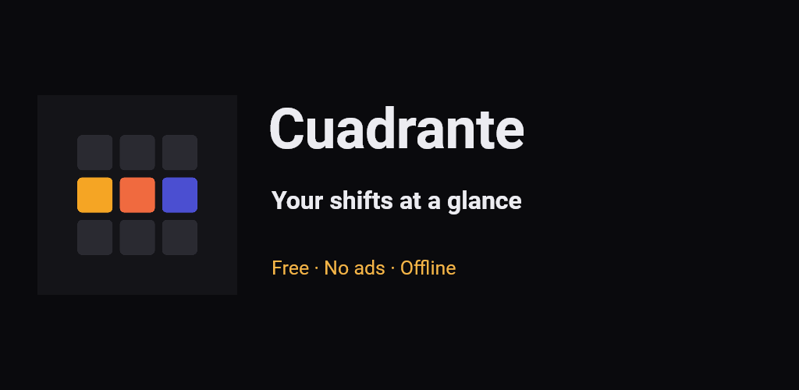
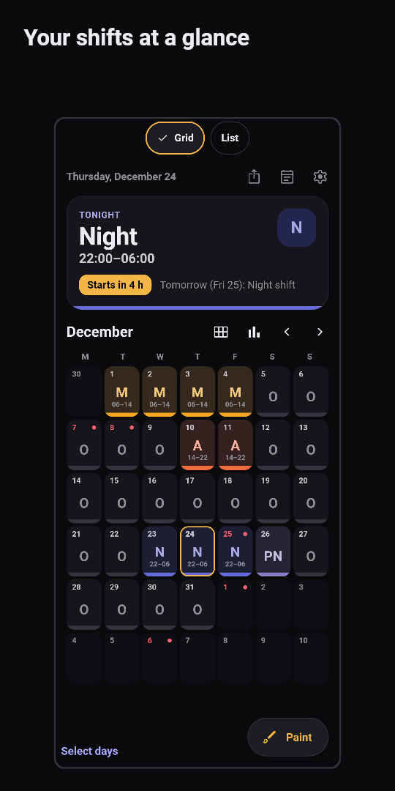
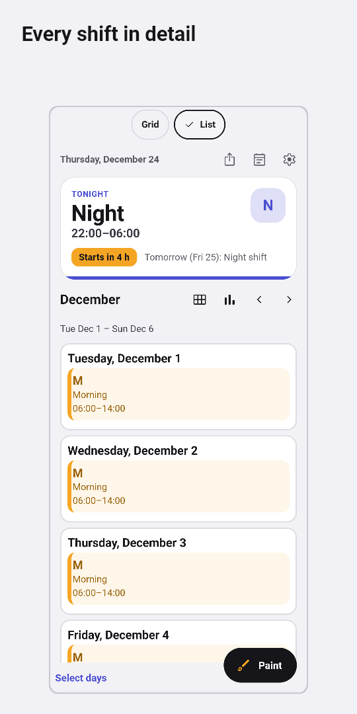
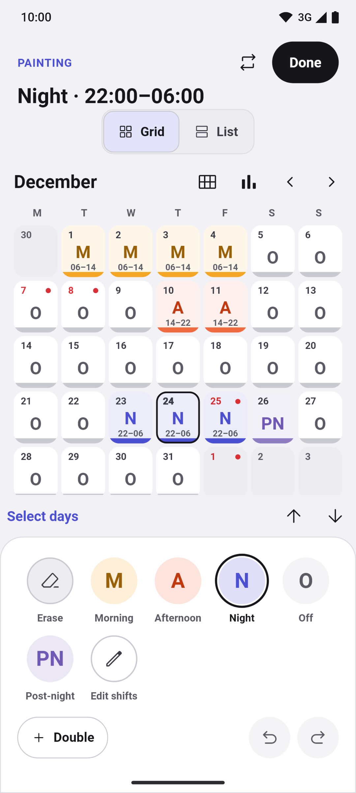
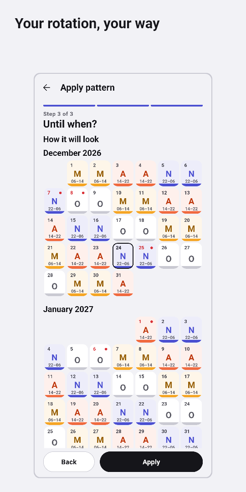
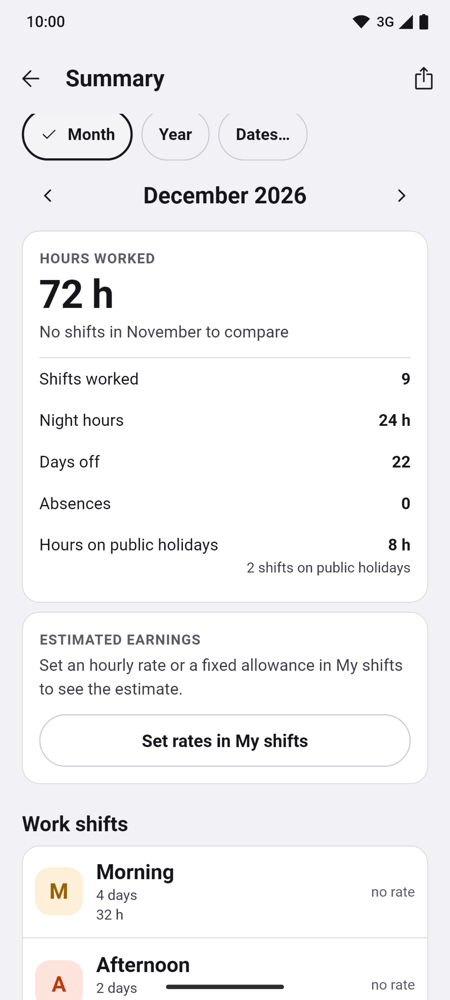
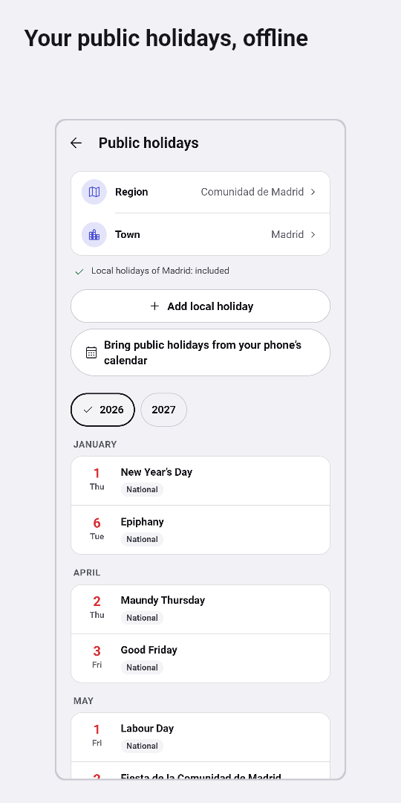
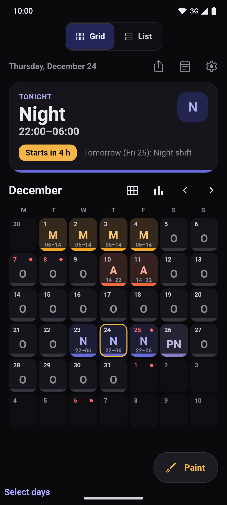

**English** · [Español](README.es.md) · [Català](README.ca.md) · [Galego](README.gl.md) · [Euskara](README.eu.md)

  

# Turnly

Formerly called Cuadrante.

A shift calendar for people who work shifts in Spain: healthcare, police,
firefighters, industry, hospitality or any other sector. Set up mornings,
afternoons, nights, on-call shifts and days off, and see your next shift at a
glance. Five languages: Spanish, Catalan, Galician, Basque and English.

**Free · No ads · No account · Works offline · Open source**

Every feature is included: no Pro tier and no in-app purchases.

## Download

  
  
  <!--
  
  -->

Android is in testing; iPhone is coming soon. Light and dark themes.

Join the beta on Google Play

Anyone can join the closed test on Google Play:

1. Join the [turnly-testers](https://groups.google.com/g/turnly-testers) group with your Google account.
2. Accept the test: [play.google.com/apps/testing/es.cuadrante.app](https://play.google.com/apps/testing/es.cuadrante.app).
3. Install the app from Google Play; it updates itself.

Please stay in the test for 14 days and open the app now and then: Google needs 12 testers for 14 days before a public release. Feedback to turnly@mainshai.com.

Install the APK from GitHub

Or download the APK of the [latest release](https://github.com/dferrandizmont/turnly/releases/latest) and install it by hand (allow installs from unknown sources). It uses a different signing key from the Google Play version, so one does not update the other: to switch, export a backup first (`.turnly`; older versions use `.cuadrante`).

## Screenshots

  
  
  
  
  

More screenshots

  
  

Tap a screenshot to enlarge it. Real screens with made-up data, generated by
[Flutter tests](app/test/store/).

## Features

- **Month in Grid or List view.** Annual view, agenda and daily notes. Every shift
  shows its colour, code and times. Export to the phone calendar and save images
  of the month or year.
- **Paint shifts and rotations.** Tap or drag across days, double shifts, copy,
  paste, undo and redo. A rotation wizard with a preview covers rotating shifts,
  24/72, 4×4, 6×4, 5×2, 2-2-3 and your own patterns. Shift types, colours, icons
  and times are editable.
- **Spanish public holidays.** National and regional dates included offline; local
  dates for supported municipalities, plus your own holidays.
- **Alarms and widgets.** An alarm per shift type, note reminders and Android
  home-screen widgets. Timing depends on system permissions and restrictions. The
  iPhone widget is still to come.
- **Backups and import.** Automatic local backups, export to `.turnly` (older `.cuadrante` backups still open), a
  restore preview and “Test restore”. Import LRHSoft `.Shifter` backups, `.ics` or
  CSV files and phone calendar events, and review the shifts before saving.
- **Hours summary.** Worked, night and public holiday hours, overtime and early
  leave, plus estimated pay from hourly rates and fixed shift allowances.

More features

- **Multiple calendars.** With no limit, and comparison between two rosters.
- **Accessibility.** Language picker, screen-reader support, larger text and
  shifts that never rely on colour alone.

## Privacy

Shifts and settings are stored on your phone. No server of ours, analytics,
tracking or crash-report uploads. It asks for **calendar** access to import or
export, and **notification and alarm** permissions for reminders.

Permissions and backups

It does not request location, contacts, camera or microphone access.

Google or Apple system backups can include your data, including absences.
Exporting to a synced calendar or sharing a backup sends data to the destination
you choose. The `.turnly` backup file is not encrypted.

[Website](https://turnly.mainshai.com/en/) · [Privacy policy](https://turnly.mainshai.com/en/privacy/) ·
[Technical details](docs/privacy.en.md) · Support: **turnly@mainshai.com**.

## What's new

See [CHANGELOG.md](CHANGELOG.md) or the [releases](https://github.com/dferrandizmont/turnly/releases).

## Contributing

Bug reports, ideas and translations are welcome. How to build, test and
contribute: [CONTRIBUTING.md](CONTRIBUTING.md).

## License

Code: [MIT](LICENSE), Copyright (c) 2026 Daniel Mont Ferrandiz. Original content:
[CC BY-SA 4.0](LICENSE-CONTENT.en.md). Official holiday sources and third-party
materials keep their own terms, detailed in those licences.

To report a vulnerability: [SECURITY.en.md](SECURITY.en.md).
